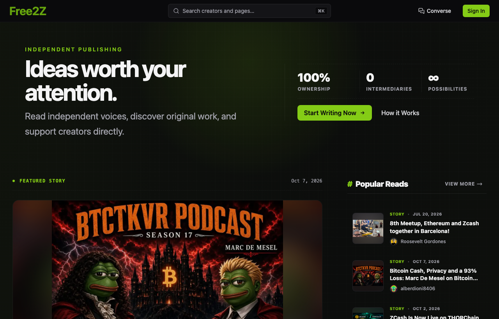
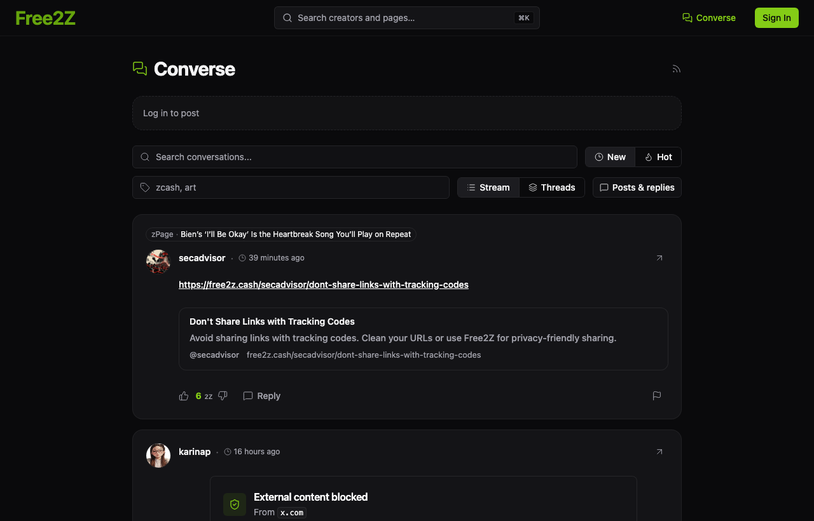
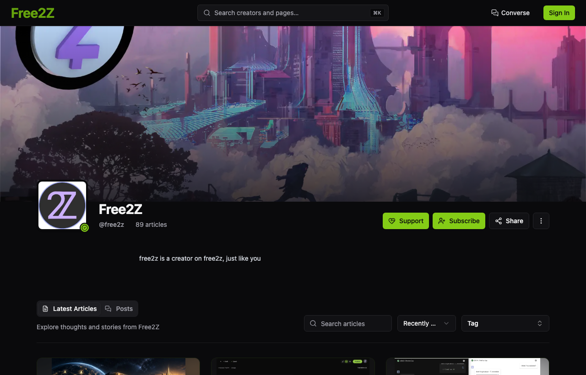

# Make Free2Z your creative space

Write, talk, experiment, and build. Free2Z gives you more ways to bring an idea to your community.

## zPages: a home for your work

Publish an article with text, images, and media. Choose public or subscriber access, share a link, and keep your work together on your profile. Readers can use the page's language and translation options to explore content in another language.

[Create a zPage](../for-creators/02-creating-a-zpage.md) · [Explore public pages](https://free2z.com/)

## Converse: small posts, real conversations

Share a short update, ask a question, or join a thread. Converse brings posts and replies into a public community feed with search, tags, and layout controls. Sign in when you want to post or reply; paid actions show their credit cost.

[Explore Converse](https://free2z.com/converse)

## Livestreams: bring people into the room

Broadcast publicly, meet your subscribers, invite people privately, or offer a pay-per-view experience. Viewers check access and the displayed price before joining. Hosts need at least 150 2Zs in their credit balance and pay the hosting costs shown in the app.

[Host a livestream](../for-creators/03-free2z-live.md) · [Watch a room](../for-supporters/free2z-live.md)

## AI: move an idea forward

Use the available AI tools to explore a question, shape a draft, or create content. Choose your model and spending controls, pay with 2Zs, and review the output before publishing it.

[Create with AI](../for-creators/AI-content-generation.md)

## Your profile and memberships

Bring your pages and biography together, offer subscriber benefits, and display an address for direct Zcash support. Memberships use credits; direct support goes to your wallet.

[Set up your profile](../for-creators/01-creating-a-profile.md) · [Join a membership](../for-supporters/subscriptions.md)

## SDK: build your own experience

The **open-source SDK preview** connects applications to Free2Z sign-in, AI services, and credit spending. Build a tutor, a writing partner, or a tool for your community. Users authorize their own spending budgets. You build and host your application; the gateway handles supported AI requests and credit charges.

[Explore the SDK preview](../for-creators/sdk-applications.md)

## Digital goods — coming soon

Explore the publishing, memberships, livestreams, and application tools you can use today.

## Credits to use. Services to earn from.

[Buy 2Zs with Zcash](../getting-started/03-tuzis.md) for platform tools and experiences. You can share credits, comment, vote, boost pages, and unlock larger uploads by holding credits.

Apply and get approved to [earn as a creator](../revenue-sharing/index.md) from qualifying delivered PPV or SDK services under accepted terms. Those earnings are recorded in USD and paid in shielded Zcash, separately from credits.
